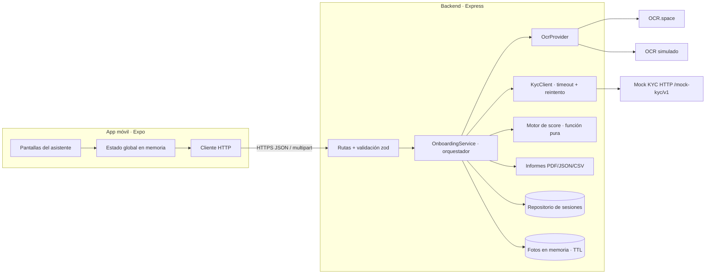
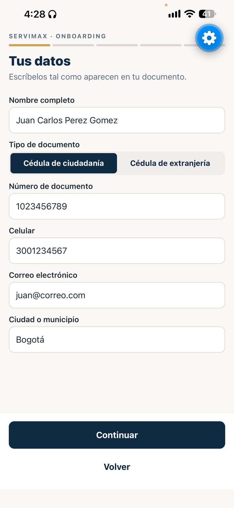
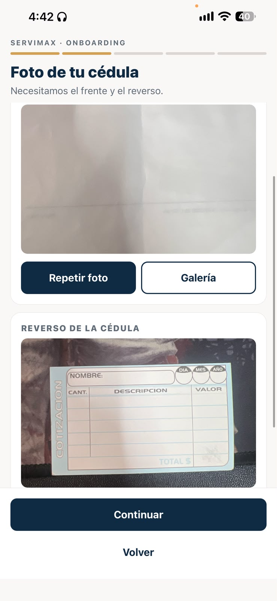
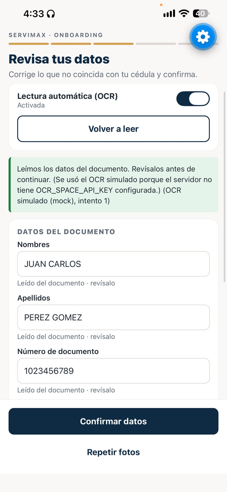
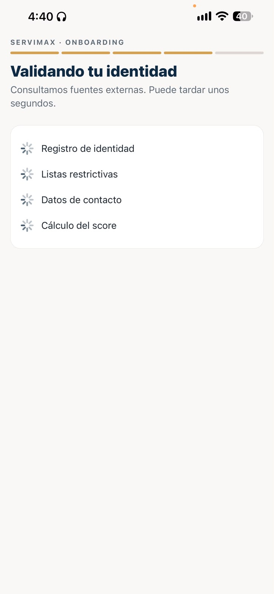
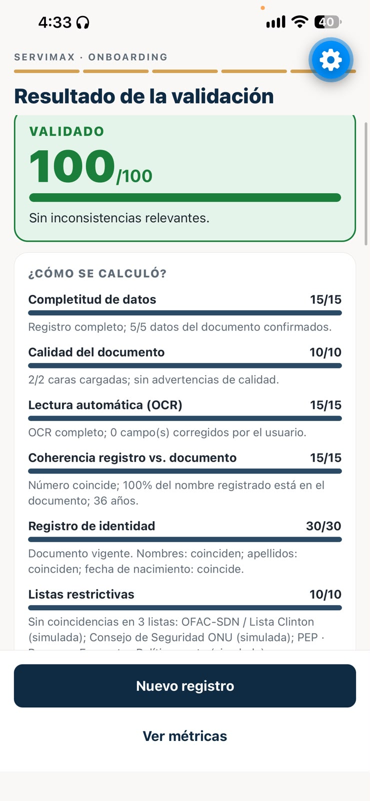

# Servimax · Onboarding KYC para tenderos

MVP móvil de registro, validación de identidad y resultado explicable.
**React Native + Expo + TypeScript** en el celular, **Node.js + Express + TypeScript** en el backend.

```
Registro → Captura de la cédula → OCR → Verificación del usuario → Consultas KYC → Score y decisión auditable → Informe PDF/JSON/CSV
```

| | |
|---|---|
| **Resultado** | `Validado` · `Requiere revisión` · `No validado`, con score 0–100 y las razones visibles |
| **OCR** | [OCR.space](https://ocr.space/ocrapi) real (gratis) o OCR simulado; se puede apagar desde la app y desde el servidor |
| **Consultas** | Proveedor KYC simulado como **servicio HTTP** documentado, con timeout, reintento y validación de respuesta |
| **Auditoría** | Bitácora de decisión por sesión + informe descargable |
| **Calidad** | 28 tests (score, lector de cédula, resiliencia KYC, flujo completo por API), OpenAPI/Swagger, Docker, CI |

---

## Contenido

1. [Cómo ejecutarlo](#1-cómo-ejecutarlo)
2. [Escenarios de prueba](#2-escenarios-de-prueba)
3. [Arquitectura](#3-arquitectura)
4. [API](#4-api)
5. [OCR](#5-ocr)
6. [Consultas KYC (mock)](#6-consultas-kyc-mock)
7. [Lógica del score](#7-lógica-del-score)
8. [Manejo de errores](#8-manejo-de-errores)
9. [Seguridad y datos personales](#9-seguridad-y-datos-personales)
10. [Decisiones técnicas](#10-decisiones-técnicas)
11. [Tests, Docker y CI](#11-tests-docker-y-ci)
12. [Evidencias y video](#12-evidencias-y-video)
13. [Antes de producción](#13-antes-de-producción)

---

## 1. Cómo ejecutarlo

**Requisitos:** Node.js 20.19+ (recomendado 22 LTS), un celular con **Expo Go** (Android o iOS) en la **misma red Wi-Fi** que el computador.

### 1.1 Backend

```bash
cd backend
npm install
cp .env.example .env        # Windows (PowerShell): copy .env.example .env
npm run dev
```

Deberías ver `API lista en http://localhost:3000`. Comprueba:

- Salud: <http://localhost:3000/health>
- Swagger: <http://localhost:3000/docs>

> **OCR real (opcional):** pide una key gratuita en <https://ocr.space/ocrapi/freekey> y ponla en `OCR_SPACE_API_KEY` dentro de `backend/.env`. Sin key, el backend usa el OCR simulado automáticamente y lo indica en `/health`.

### 1.2 App móvil

```bash
cd mobile
npm install
npx expo install --fix      # alinea versiones con el SDK de Expo instalado
cp .env.example .env        # Windows: copy .env.example .env
```

Edita `mobile/.env` y pon la **IP de tu computador** (no `localhost`, porque el celular es otro dispositivo):

```bash
# Windows: ipconfig → "Dirección IPv4"   ·   macOS/Linux: ipconfig getifaddr en0 / hostname -I
EXPO_PUBLIC_API_URL=http://192.168.1.10:3000
```

```bash
npx expo start
```

Escanea el QR con Expo Go (Android) o con la cámara (iOS). La pantalla de inicio muestra si la app se conectó al backend y qué OCR está activo.

> **Si Expo Go dice que el proyecto es de otra versión de SDK:** ejecuta `npx expo install expo@latest` y luego `npx expo install --fix`. Expo Go solo abre proyectos del SDK más reciente.
>
> **Si la app no conecta:** revisa que el firewall de Windows permita Node en redes privadas y que ambos equipos estén en la misma Wi-Fi.

---

## 2. Escenarios de prueba

Los servicios simulados deciden su respuesta según el **último dígito del número de documento**. Así se puede demostrar cada camino del flujo sin depender de terceros.

| Último dígito | Qué simula | Resultado esperado |
|---|---|---|
| **8** o **9** | Todo correcto | ✅ Validado · 100/100 |
| **0** | El registro de identidad dice que los apellidos no coinciden | 🟡 Requiere revisión |
| **1** | Coincidencia en listas restrictivas | 🔴 No validado |
| **2** | Documento cancelado | 🔴 No validado |
| **3** | El servicio de identidad no responde a tiempo (timeout + reintento) | 🟡 Requiere revisión + opción "Reintentar consultas" |
| **4** | El servicio de identidad está caído (HTTP 503 + reintento) | 🟡 Requiere revisión + opción "Reintentar consultas" |
| **5** | El servicio responde un JSON con formato inesperado | 🟡 Requiere revisión |
| **6** | *(OCR simulado)* No se lee nada del documento | Opciones: reintentar, repetir fotos, digitar o revisión manual |
| **7** | *(OCR simulado)* Se lee mal un dígito del número | El usuario ve la diferencia y corrige |

Otros casos que puedes probar desde la app: apagar el OCR (queda en revisión), corregir un campo leído, fecha de nacimiento de un menor de edad (No validado), correo `@yopmail.com` (alerta), cancelar la cámara, negar permisos, apagar el backend a mitad del flujo.

---

## 3. Arquitectura

**Móvil delgado, backend que orquesta.** La app captura y guía; el backend valida, consulta, decide y protege las integraciones (las API keys nunca salen del servidor).



### Estructura

```
backend/
  src/
    config/env.ts              Variables de entorno (único lugar con secretos)
    domain/                    Tipos, esquemas zod y utilidades de texto
    services/
      onboardingService.ts     Orquesta cada paso y escribe la bitácora
      scoring.ts               Motor de score y decisión (función pura)
      report.ts                Informe JSON / CSV / PDF
      ocr/                     Interfaz OcrProvider, OCR.space, mock y lector de cédula
      kyc/                     Cliente KYC + escenarios y servidor del mock
    repositories/              Persistencia de sesiones + bóveda de fotos en memoria
    routes/ middleware/        HTTP, manejo uniforme de errores, log de acceso
  tests/                       node:test (unitarios + integración)
  openapi.yaml  Dockerfile  .env.example
mobile/
  App.tsx                      Router por pasos + botón atrás de Android + ErrorBoundary
  src/
    api/                       Cliente HTTP (timeouts, errores con código) y endpoints
    state/                     Estado del recorrido (useReducer + Context)
    screens/                   Bienvenida, Registro, Captura, OCR/Revisión, Consultas, Resultado, Métricas
    components/                UI reutilizable y ErrorBoundary
    utils/                     Captura/compresión de fotos y descarga de informes
    validation.ts              Mismas reglas de validación que el backend
```

≈ 2.600 líneas de código efectivas (sin contar tests, comentarios ni líneas en blanco).

---

## 4. API

Documentación interactiva en **`/docs`** (Swagger, generado desde `backend/openapi.yaml`).

| Método | Ruta | Paso |
|---|---|---|
| `POST` | `/api/v1/onboarding` | Crea la sesión con el registro (valida formato y obligatoriedad) |
| `POST` | `/api/v1/onboarding/:id/documents` | Frente y reverso (`multipart/form-data`, JPG/PNG) |
| `POST` | `/api/v1/onboarding/:id/ocr` | Ejecuta el OCR (`{ "useOcr": true }`) o lo salta |
| `PUT` | `/api/v1/onboarding/:id/confirmation` | Datos revisados/corregidos por el usuario |
| `POST` | `/api/v1/onboarding/:id/manual-review` | Escala a revisión manual |
| `POST` | `/api/v1/onboarding/:id/verification` | Consultas KYC + score + decisión (repetible para reintentar) |
| `GET` | `/api/v1/onboarding/:id` | Sesión completa con bitácora |
| `GET` | `/api/v1/onboarding/:id/report?format=pdf\|json\|csv` | Informe descargable |
| `GET` | `/api/v1/metrics` | Registros, validaciones, revisiones, consultas, errores, duración y score promedio |
| `GET` | `/health` | Estado y OCR activo |

Todos los errores tienen la misma forma, con un código estable que la app usa para elegir el mensaje y la salida:

```json
{ "error": { "code": "LOW_QUALITY_IMAGE", "message": "La foto del frente tiene muy baja resolución...", "details": { "side": "front" } } }
```

---

## 5. OCR

- **Desacoplado** detrás de la interfaz `OcrProvider` (`extractText`). Hay dos implementaciones: `OcrSpaceProvider` (real) y `MockOcrProvider`. Cambiar a Google Vision o AWS Textract es agregar una clase.
- **Activable/desactivable** en dos niveles: `OCR_ENABLED` en el servidor (interruptor global) y el switch "Lectura automática" en la app (por sesión). Sin OCR el usuario digita los datos y el caso queda en revisión, porque nadie contrastó los datos con el documento.
- **Lector de cédula** (`cedulaParser.ts`): convierte el texto plano en nombres, apellidos, número, fecha y lugar de nacimiento, fecha y lugar de expedición. Soporta la cédula amarilla (etiqueta debajo del valor) y la digital (etiqueta encima).
- **Resultados posibles:** `SUCCESS`, `PARTIAL` (indica qué falta), `NO_RESULTS`, `FAILED` (servicio caído) y `SKIPPED`. Los fallos del proveedor **no** se devuelven como error HTTP: responden 200 con el estado y un mensaje, para que la app ofrezca reintentar, repetir fotos, digitar o pasar a revisión manual sin perder nada.
- **Transparencia del proveedor:** la lectura, la app, `/health` y el informe indican qué OCR se usó y, si fue el simulado, por qué (por ejemplo, falta de `OCR_SPACE_API_KEY`). Así el evaluador no confunde el mock con un OCR real que falla.
- La app reduce la foto a 1600 px y la comprime a JPEG (el plan gratis de OCR.space acepta hasta 1 MB y así se ahorran datos móviles).

---

## 6. Consultas KYC (mock)

Usecroma (o cualquier proveedor) se reemplazó por un **mock claramente documentado**, pero implementado como **servicio HTTP real** en `/mock-kyc/v1`, protegido con `x-api-key`. El backend lo consume exactamente como consumiría al proveedor:

| Consulta | Endpoint | Qué envía (minimización) | Qué valida |
|---|---|---|---|
| Registro de identidad | `POST /identity/verify` | tipo y número, nombres, apellidos, fecha de nacimiento | encontrado, estado del documento, coincidencia por campo |
| Listas restrictivas | `POST /watchlists/screen` | número y nombre | coincidencias en 3 listas simuladas: OFAC-SDN / Lista Clinton, Consejo de Seguridad ONU y PEP (Personas Expuestas Políticamente) |
| Datos de contacto | *(regla interna)* | — | correo de dominio temporal |

**Resiliencia** (`kycClient.ts`): timeout por consulta (`KYC_TIMEOUT_MS`), 1 reintento con espera para fallos transitorios (timeout, red, 5xx), validación de la respuesta con zod, y conversión de cualquier fallo en un resultado `ERROR`/`TIMEOUT` que el score sabe interpretar. Las consultas corren **en paralelo**.

**Para usar un proveedor real:** cambiar `KYC_BASE_URL` y `KYC_API_KEY`, y adaptar el mapeo de la respuesta en `kycClient.ts` a su contrato.

---

## 7. Lógica del score

`backend/src/services/scoring.ts` es una **función pura**: con la misma sesión siempre da el mismo resultado, y por eso tiene tests de cada regla.

### Factores (suman 100)

| Factor | Máx. | Cómo se obtiene |
|---|---|---|
| Completitud de datos | 15 | 5 por el registro + 10 proporcionales a los 5 datos del documento confirmados |
| Calidad del documento | 10 | 3 por cada cara + 4 si no hay advertencias de calidad (−2 por advertencia) |
| Lectura automática (OCR) | 15 | 15 lectura completa / 8 parcial / 0 sin OCR; −2 por cada campo corregido por el usuario |
| Coherencia registro vs. documento | 15 | 7 si el número coincide + 6 × % del nombre registrado presente en el documento + 2 si es mayor de edad |
| Registro de identidad | 30 | 30 si todo coincide; si hay diferencias: 10 + 6 (nombres) + 7 (apellidos) + 7 (nacimiento); 0 si cancelado, no encontrado o sin respuesta |
| Listas restrictivas | 10 | 10 sin coincidencias; 0 si hay coincidencia o no se pudo consultar |
| Datos de contacto | 5 | 5 normal; 2 con correo temporal |

### Alertas y decisión

| Severidad | Ejemplos | Efecto |
|---|---|---|
| **CRITICAL** | listas restrictivas, documento cancelado, menor de edad | **No validado** y el score se limita a 30 |
| **HIGH** | servicio KYC sin respuesta, datos que no coinciden con el registro, número distinto al registrado, OCR no disponible, revisión manual solicitada | Como máximo **Requiere revisión** (score ≤ 79) |
| **MEDIUM / LOW** | correcciones al OCR, nombre parcialmente coincidente, correo temporal, calidad de imagen | Restan puntos, no bloquean |

Sin alertas que limiten: **≥ 80 Validado · 50–79 Requiere revisión · < 50 No validado**. Esta regla se muestra en la pantalla de resultado y en el informe.

**Por qué así:** el principio es que *nunca se valida automáticamente algo que no se pudo verificar*. Si un servicio cae o el OCR no lee, el caso no se rechaza (sería un falso negativo injusto con el tendero) ni se aprueba (sería un riesgo): pasa a revisión humana con la razón explícita.

---

## 8. Manejo de errores

Regla: **ningún error cierra la app ni borra lo que el usuario ya hizo.** El estado del recorrido vive fuera de las pantallas, y un `ErrorBoundary` atrapa cualquier fallo de dibujo.

| Situación | Qué ve el usuario | Salidas |
|---|---|---|
| Campo vacío o con formato inválido | Mensaje bajo el campo (validación en app y servidor) | Corregir |
| Cancela la cámara / niega permisos | Aviso en la tarjeta de esa cara | Tomar de nuevo, usar galería, ir a Ajustes |
| Falta una cara de la cédula | "Falta la foto del reverso…" | Tomar la foto |
| Imagen dañada, de muy baja resolución o pesada | El servidor indica qué cara falló y por qué | Repetir esa foto |
| OCR sin resultados / servicio OCR caído | Explicación de la causa probable | Reintentar lectura, repetir fotos, digitar, revisión manual |
| OCR lee un número distinto al registrado | Aviso bajo el campo | Corregir (queda registrado como corrección) |
| Fotos expiradas en el servidor (30 min) | "Vuelve a cargarlas" | Repetir fotos |
| Proveedor KYC caído / timeout / respuesta inválida | Resultado "Requiere revisión" con la causa | Reintentar consultas |
| Backend sin conexión o lento | Mensaje claro, datos conservados | Reintentar |
| Falla al generar o compartir el informe | Mensaje por formato | Reintentar u otro formato |
| Botón atrás de Android | Retrocede un paso (no cierra la app) | — |

---

## 9. Seguridad y datos personales

**Controles implementados**

- Las API keys (OCR.space, proveedor KYC) existen **solo en el backend**, leídas de variables de entorno. La app únicamente conoce `EXPO_PUBLIC_API_URL`, que no es secreta.
- `.env` está en `.gitignore`; el repositorio solo incluye `.env.example` sin secretos.
- **Logs sin datos personales:** el logger redacta automáticamente nombres, documento, correo, teléfono, fechas, textos del OCR e imágenes; el log de acceso reemplaza los IDs por `:id`.
- Validación de toda entrada con zod (incluido `strict`, que rechaza campos inesperados) y límites de tamaño: JSON 50 KB, fotos 5 MB, 2 archivos.
- El tipo de imagen se verifica por su **contenido** (cabecera JPG/PNG), no por la extensión.
- `helmet` (cabeceras de seguridad), rate limit (120 peticiones/min por IP), CORS cerrado por defecto, sin stack traces en las respuestas, IDs de sesión UUID v4 no adivinables.
- El informe enmascara documento, celular y correo.

**Qué se guarda, cuánto tiempo y por qué**

| Dato | Dónde | Cuánto tiempo | Por qué |
|---|---|---|---|
| Fotos de la cédula | Solo **memoria RAM** del servidor | Se borran al confirmar los datos, o a los 30 min | Se necesitan solo para el OCR |
| Fotos en el celular | Memoria de la app | Se sueltan al confirmar | Vista previa y reenvío |
| Registro, datos confirmados, consultas, score, bitácora | `backend/data/sessions.json` (permisos 600) | 72 h (`SESSION_TTL_HOURS`), luego se purgan | Auditoría del resultado y métricas |
| Informes descargados | Caché de la app | Hasta que el sistema limpie la caché | Compartirlos |

Nada se guarda de forma persistente en el celular.

---

## 10. Decisiones técnicas

| Decisión | Por qué | Alternativa descartada |
|---|---|---|
| Express + TypeScript | Mismo lenguaje en app y backend; tipos compartidos de forma natural | NestJS: más estructura, pero más código para un MVP |
| Proveedores detrás de interfaces (`OcrProvider`, cliente KYC por URL) | Cambiar mock ↔ real sin tocar la lógica; facilita los tests | Llamar al proveedor directo desde las rutas |
| Mock KYC como servicio HTTP | Demuestra la integración real (API key, timeout, reintento, validación) | Funciones que devuelven datos fijos |
| Score como función pura | Explicable, reproducible y testeable | Reglas dispersas en varios archivos |
| Fallos de OCR/KYC como resultados, no excepciones | El flujo nunca se rompe; la decisión los interpreta | Propagar errores 500 a la app |
| Repositorio con archivo JSON | Cero instalación para el evaluador; misma interfaz que tendría PostgreSQL | Base de datos que exige configurar un servidor |
| Navegación por pasos con `useReducer` | El flujo es lineal; estado y pantalla nunca se desincronizan; menos dependencias | React Navigation / Expo Router |
| `node:test` + `tsx` | Sin dependencias extra de testing | Jest/Vitest |
| Validación duplicada (app + servidor) | Respuesta inmediata al usuario + seguridad real en el servidor | Validar solo en un lado |

---

## 11. Tests, Docker y CI

```bash
cd backend
npm test            # 28 tests: score, lector de cédula, cliente KYC y flujo completo por API
npm run typecheck
```

| Archivo | Qué prueba |
|---|---|
| `scoring.test.ts` | Cada regla de decisión: favorable, KYC caído, listas, cancelado, sin OCR, número distinto, menor de edad, correcciones, revisión manual |
| `cedulaParser.test.ts` | Lectura de cédula amarilla y digital, OCR simulado, normalización y edad |
| `kycClient.test.ts` | Timeout con reintento, 503 con reintento, respuesta inválida sin reintento, listas, contacto |
| `api.test.ts` | Flujo completo por HTTP: validación, foto faltante, validado + informes, KYC caído, OCR sin resultados |

**Docker** (backend): `cp backend/.env.example backend/.env && docker compose up --build`

**CI** (`.github/workflows/ci.yml`): en cada push verifica tipos, corre los tests y compila el backend; verifica tipos y versiones de Expo en la app.

---

## 12. Evidencias y video

- 📹 **Video (≤ 2 min):** [Ver demo en YouTube](https://www.youtube.com/watch?v=AQEisKq-e3M): recorrido completo en un iPhone con Expo Go
- 🖼️ **Capturas:** carpeta [`docs/evidencias/`](docs/evidencias/)
- 📄 **Informes generados por la app** (uno por cada resultado posible):

| Caso | Documento termina en | Resultado | Por qué | Informe |
|---|---|---|---|---|
| Favorable | 9 | Validado · 100/100 | Sin alertas | [PDF](docs/evidencias/informe-1-validado.pdf) |
| Apellidos no coinciden con el registro | 0 | Requiere revisión · 79/100 | Suma 93, limitada a 79 por alerta ALTA | [PDF](docs/evidencias/informe-2-requiere-revision.pdf) |
| Coincidencia en lista restrictiva (OFAC simulada) | 1 | No validado · 30/100 | Suma 90, limitada a 30 por alerta CRÍTICA | [PDF](docs/evidencias/informe-3-no-validado.pdf) |

| Registro | Captura | OCR y revisión | Consultas | Resultado |
|---|---|---|---|---|
|  |  |  |  |  |

---

## 13. Antes de producción

Este MVP prioriza demostrar el flujo. Para operar con tenderos reales cambiaría lo siguiente:

**Seguridad**
- Autenticación del tendero (OTP por SMS/WhatsApp al celular registrado) y tokens de sesión cortos; hoy cualquiera con el UUID de una sesión puede leerla.
- HTTPS obligatorio con TLS 1.2+, *certificate pinning* en la app y secretos en un gestor (AWS Secrets Manager, GCP Secret Manager o Vault) con rotación.
- Detección de vida (*liveness*) y comparación del rostro con la foto de la cédula: hoy alguien podría usar la cédula de otra persona.
- Detección de documentos alterados o fotos de pantallas; escaneo de archivos cargados; WAF y rate limit por usuario además de por IP.

**Privacidad (Ley 1581 de 2012 – Habeas Data)**
- Autorización expresa de tratamiento de datos antes de capturar, con versión y fecha guardadas; aviso de privacidad y finalidad clara.
- Cifrado de datos personales en reposo (columnas sensibles cifradas con KMS) y en tránsito.
- Política formal de retención y borrado, y procedimientos para que el titular consulte, corrija o pida eliminar sus datos.
- Acceso por roles (asesor, auditor, administrador) con registro de quién vio qué.

**Escalabilidad**
- PostgreSQL en lugar del archivo JSON (el repositorio ya está detrás de una interfaz); Redis para estado temporal.
- OCR y consultas como trabajos asíncronos en una cola (BullMQ, SQS) con notificación a la app, en vez de esperar la respuesta HTTP.
- Backend sin estado en varias instancias detrás de un balanceador; las fotos en almacenamiento temporal cifrado, no en la RAM de una instancia.

**Costos y confiabilidad de APIs**
- Proveedores OCR/KYC con SLA y contrato; el plan gratis de OCR.space tiene límites de uso y de tamaño.
- *Circuit breaker* y proveedor alterno (por ejemplo, OCR de respaldo), caché de consultas recientes del mismo documento para no pagar dos veces, e idempotencia en las consultas.
- Presupuesto y alertas de costo por consulta; métricas de latencia y tasa de error por proveedor.

**Auditoría y trazabilidad**
- Bitácora inmutable (*append-only*) con firma o hash encadenado, guardada aparte de los datos operativos.
- Versión del motor de score y de las reglas guardada en cada decisión, para explicar decisiones antiguas aunque las reglas cambien.
- ID de correlación en cada petición, propagado a los proveedores, para seguir un caso de punta a punta.
- Registro de quién resolvió cada revisión manual, cuándo y por qué.

**Almacenamiento de documentos**
- Si la regulación o el negocio exigen conservar las fotos: almacenamiento de objetos cifrado (S3 con SSE-KMS), URLs firmadas de corta duración, acceso restringido y borrado automático por política.
- Si no lo exigen: mantener el enfoque actual de no conservarlas.

**Falsos positivos y negativos**
- Hoy los umbrales (80/50) y los pesos son razonables pero no calibrados. Con datos reales: medir cuántos casos validados resultan fraudulentos (falsos positivos) y cuántos rechazados eran legítimos (falsos negativos), y ajustar.
- Las coincidencias en listas restrictivas por nombre generan muchos falsos positivos: siempre deben ir a revisión humana con el contexto, nunca rechazo automático sin revisar.
- Comparación de nombres más tolerante (distancia de edición para errores de OCR, nombres compuestos, tildes).
- Tablero de casos en revisión con tiempos de respuesta, para que la revisión humana no se vuelva un cuello de botella.

**Monitoreo**
- Logs centralizados (CloudWatch, Datadog o ELK) manteniendo la redacción de datos personales; métricas (Prometheus/Grafana) de latencia, errores por paso, tasa de abandono y distribución de decisiones; alertas cuando un proveedor falla o la tasa de "No validado" se dispara.
- Reporte de errores en la app (Sentry) sin datos personales.
- Pruebas end-to-end automáticas del flujo (Maestro o Detox) en CI.
